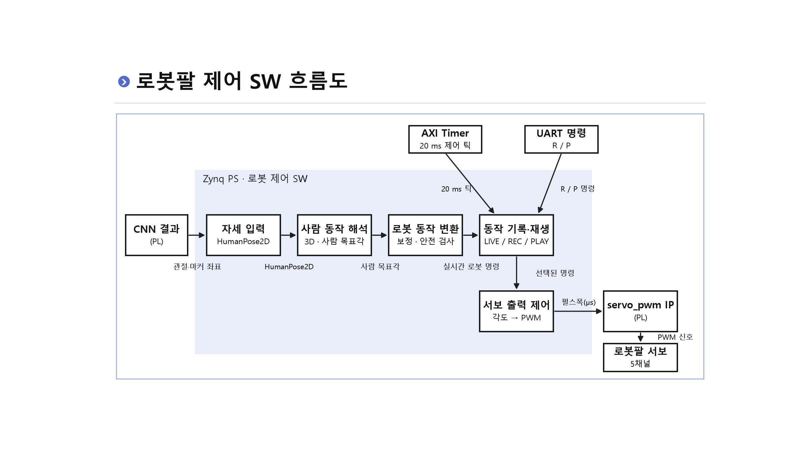

# 스테레오 비전 기반 3D 동작 추종 로봇팔

> 개인 담당 구현을 소개하는 문서입니다. 최신 전체 소스 구성·실행 방법·검증 상태는 팀 통합 담당자가 작성한 [프로젝트 README](README.md)와 [펌웨어 README](robot_arm/README.md)를 우선합니다. 아래 개발 과정 문서는 당시 이력으로 함께 보존합니다.

**Zybo Z7-20 · Zynq-7020 · ARM Cortex-A9 · C/Python · Vitis**

좌우 카메라에서 얻은 관절·마커 좌표로 3D 위치를 복원하고, 사람의 전완·손목·그리퍼 움직임을 로봇팔의 5개 제어 채널로 연결한 팀 프로젝트입니다. CNN 입력부터 목표각 계산, 로봇 보정·PWM 출력, 동작 녹화·재생과 Unity 연동까지 구성했습니다.

[노션 상세·시연 영상](https://app.notion.com/p/3f723ec941b7816881c9fe81751f1529) · [전체 포트폴리오](https://app.notion.com/p/09623ec941b782e6a750819f197c7713) · [팀 원본 저장소](https://github.com/realisshoon/zynq-cnn-motion-robot-soc)

## 이민 담당 역할

| 담당 | 구현 내용 | 먼저 볼 코드 |
| --- | --- | --- |
| 스테레오 3D 좌표 생성 | 좌우 관측의 대응·유효성을 확인하고 카메라 기준 mm 단위 좌표로 복원 | [stereo_pose.c](robot_arm/src/app/robot/vision/stereo/stereo_pose.c), [stereo_geometry.c](robot_arm/src/app/robot/vision/stereo/stereo_geometry.c), [stereo_link.c](robot_arm/src/app/robot/vision/stereo/stereo_link.c) |
| 사람 팔 각도 계산 | 전완 벡터로 방향각을 계산하고 손목·그리퍼 목표값과 각도 연속성·누락 처리를 구성 | [forearm_mapping.c](robot_arm/src/app/robot/vision/human_target/forearm_mapping.c), [pose_hand.c](robot_arm/src/app/robot/vision/human_target/pose_hand.c) |
| UART 설계 | 보드 간 관측 데이터와 PC 제어 명령·상태 응답의 통신 경로 연결 | [stereo_uart_protocol.c](robot_arm/src/app/robot/vision/stereo/stereo_uart_protocol.c), [UART 계약](robot_arm/docs/uart_protocol_unity.md) |
| 시스템 통합 | CNN 입력, 사람 목표값, 로봇 보정·출력, 녹화·재생 모듈의 데이터 계약과 실행 주기 연동 | [main.c](robot_arm/src/app/main.c), [robot_motion.c](robot_arm/src/app/robot/control/robot_motion.c) |

CNN 가속기와 로봇 보정·안전검사, 서보 출력·녹화 모듈은 팀에서 분담했습니다. 위 표는 개인 담당과 연결한 범위입니다.

## 동작 구조

| 단계 | 처리 |
| --- | --- |
| 영상 입력 | 좌우 영상의 관절·마커를 관측하고 대응 프레임의 유효성 확인 |
| 스테레오 복원 | 왼쪽 카메라 원점 기준의 3D 좌표 생성 |
| 사람 목표값 | Elbow Roll/Pitch, Wrist Pitch/Roll, Gripper 계산 |
| 로봇 보정·제어 | 서보 방향·영점·가동범위와 안전 조건을 반영해 승인 목표 갱신 |
| 출력·기록 | 20 ms 제어 틱에서 목표 추종·PWM 적용과 모드별 녹화·재생 수행 |

영상 입력에 따른 **목표값 갱신**과 AXI Timer의 **20 ms 제어 틱**을 분리했습니다. 입력이 잠시 끊겨도 마지막으로 승인한 목표까지 제어를 이어가고, 도착 후 명령 자세를 유지하는 구조입니다.

## 문제 해결 — 상대 Z에서 고정 카메라 기준 3D로 전환

초기에는 양어깨로 만든 신체 기준축과 상대 Z를 사용했습니다. 몸통이나 어깨가 팔과 함께 회전하면 기준축도 바뀌어 전완의 상대 회전각이 줄거나 방향이 뒤집히는 문제가 있었습니다.

스테레오 경로를 **고정된 왼쪽 카메라 원점의 실측 좌표**로 바꾸고, 각도 계산에 사람의 오른쪽·위쪽·전방 기준을 적용했습니다. 최종 스테레오 전완 각도 경로에서는 어깨 검출에 따라 기준축이 흔들리지 않도록 했습니다.

- 3D 좌표는 mm 단위로 보존하고, 각도 계산에서만 카메라 X·Z 방향을 사람 기준에 맞춰 변환
- ±180° 경계의 unwrap과 입력 누락 시 HOLD 처리
- 수직 자세에서 관측하기 어려운 수평 방향은 마지막 관측값 유지
- 손가락 관측 누락 시 전완과 손목·그리퍼 갱신 조건을 나눠 처리

[좌표·각도 정의와 회귀 항목](robot_arm/docs/stereo_absolute_angles.md)

## 결과와 검증

- **실물 시연:** 스테레오 입력에 따른 로봇팔 추종과 동작 녹화·재생을 확인했습니다. [시연 영상·설명](https://app.notion.com/p/3f723ec941b7816881c9fe81751f1529)
- **소프트웨어 검증 코드:** 고정 기준 각도, 어깨 변화·누락 독립성, 손목 부호, 중복·실패 입력과 HOLD 등을 검사하는 [스테레오 각도 테스트](robot_arm/tests/human_target_angle/test_forearm_stereo_absolute.c)를 포함합니다.
- **통합·릴리스 기록:** 역할별 빌드와 호스트 회귀 범위는 [통합 기록](robot_arm/docs/seungyeol3_release.md)에 정리했습니다. 호스트 회귀와 실제 보드 시연은 검증 범위가 다릅니다.

## 코드 읽는 순서

1. [스테레오 3D·사람 각도 계약](robot_arm/docs/stereo_absolute_angles.md) — 입력 좌표, 기준축, 5개 목표값
2. [forearm_mapping.c](robot_arm/src/app/robot/vision/human_target/forearm_mapping.c) — 스테레오 좌표에서 전완 목표각 계산
3. [pose_hand.c](robot_arm/src/app/robot/vision/human_target/pose_hand.c) — 손목·그리퍼 처리
4. [robot_motion.c](robot_arm/src/app/robot/control/robot_motion.c) — 사람 목표값과 로봇 보정·출력의 연결
5. [main.c](robot_arm/src/app/main.c) — CNN 서비스와 프레임·20 ms 제어 경로

## 개발·운영 문서

| 자료 | 내용 |
| --- | --- |
| [이전 통합 기록](robot_arm/docs/integration_work_plan.md) | CNN·제어 틱·UART·녹화 경로의 계약 |
| [UART·Unity 연동](robot_arm/docs/uart_protocol_unity.md) | 명령, 상태 응답, 호스트와 보드의 상태 구분 |
| [로봇별 명령](robot_arm/docs/robot0_robot1_commands.md) | LEFT/RIGHT 역할과 제어 명령 |
| [Vitis 설정 스크립트](robot_arm/vitis/setup_vitis.ps1) | 역할별 보드 빌드 환경 설정 |
| [모듈별 테스트](robot_arm/tests) | 사람 각도·보정·출력·통합 회귀 |
| [최신 펌웨어 README](robot_arm/README.md) | 개발 과정과 상세 참고 자료 |

현재 펌웨어 실행 소스는 `robot_arm/src`, `robot_arm/include`, `robot_arm/config`입니다. 현행 경로는 **5개 제어 채널**이며, 기존 개발 README의 과거 6축·단안 예시는 당시 이력입니다. 빌드와 UART 동작은 위의 현행 통합·역할별 문서를 우선해 확인합니다.
